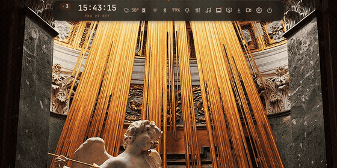

<div align="center">

# reddot

A Hyprland desktop built around one morphing Quickshell pill.

Personal fork of [Ricelin](https://github.com/Gakuseei/Ricelin), maintained on a ThinkPad E14 Gen 7.


</div>

One pill replaces the status bar and the usual launcher, mixer and settings
windows. It starts as a thin strip, expands in place, and returns to the strip
when you leave. **42 surfaces**, no background daemon for the shell itself.

Clean-workspace captures. Personal window titles are redacted.

## Find and focus

<table align="center">
<tr>
<td width="50%" align="center" valign="top">
  <br>
  <sub><b>Launcher</b><br>Apps, commands and inline math in one field</sub>
</td>
<td width="50%" align="center" valign="top">
  <br>
  <sub><b>Search</b><br>Type <code>wifi</code>; aliases and keywords find the page</sub>
</td>
</tr>
<tr>
<td width="50%" align="center" valign="top">
  <br>
  <sub><b>Bar</b><br>Zones, status order and component widgets</sub>
</td>
<td width="50%" align="center" valign="top">
  <br>
  <sub><b>Game mode</b><br>Target window, keep list and scoped cleanup</sub>
</td>
</tr>
</table>

## Own the machine

<table align="center">
<tr>
<td width="50%" align="center" valign="top">
  <br>
  <sub><b>ThinkPad</b><br>Fan, LEDs, TrackPoint and BIOS</sub>
</td>
<td width="50%" align="center" valign="top">
  <br>
  <sub><b>Power &amp; battery</b><br>Profile, charge window and presets</sub>
</td>
</tr>
<tr>
<td width="50%" align="center" valign="top">
  <br>
  <sub><b>System packages</b><br>Native, AUR and Flatpak pending updates</sub>
</td>
<td width="50%" align="center" valign="top">
  <br>
  <sub><b>System monitor</b><br>CPU, iGPU, memory, sensors and pressure</sub>
</td>
</tr>
</table>

## Control and feedback

<table align="center">
<tr>
<td width="50%" align="center" valign="top">
  <br>
  <sub><b>Audio</b><br>Output, microphone, faders and routing</sub>
</td>
<td width="50%" align="center" valign="top">
  <br>
  <sub><b>Recorder</b><br>Screen capture and source selection</sub>
</td>
</tr>
<tr>
<td width="50%" align="center" valign="top">
  <br>
  <sub><b>Notices</b><br>Battery, charger, mic and peripheral events</sub>
</td>
<td width="50%" align="center" valign="top">
  <br>
  <sub><b>Settings</b><br>Grouped desktop, controls and system pages</sub>
</td>
</tr>
</table>

## Use it

- Hover the top strip, or press `Super+Shift+Space`, to open the pill.
- `Super+A` opens the launcher; `Search` finds settings and controls.
- Wheel, scrollbar, `PageUp`/`PageDown`, `Home` and `End` scroll long pages.
- The back control returns to the parent page; `Escape` closes the surface.
- Status items are ordered in `~/.local/state/reddot/bar.json`.
- `System packages` keeps its download glyph at zero and grows only with the count badge.

Search is metadata-driven:

```text
wifi → Wi-Fi            mic → Audio mixer / Pill & notices
fan  → ThinkPad         pacman → System packages
bios → ThinkPad         widgets → Bar & widgets
```

## Game mode

Open **Power & battery → Game mode**, or click the gamepad chip in the Mixer.
Choose the game window, mark the apps to keep, then start. The mode strips
Hyprland decorations and animations, enables DND and keep-awake, pauses the
visualizer, and keeps the target tree and allowlist alive.

Closing other apps is opt-in and uses SIGTERM after confirmation. The helper only
considers mapped Hyprland windows and protects the game tree, allowlisted apps,
Steam/Gamescope and session services. It exits when the target window closes.

## Install

```sh
curl -fsSL https://raw.githubusercontent.com/SrRenks/reddot/e14g7/install.sh | bash
```

Supported: Arch, Debian 13+, Fedora 44+ and openSUSE Tumbleweed. The bootstrap
installs `git` and `rustc`; the installer backs up replaced files. See
[docs/getting-started.md](docs/getting-started.md) for flags such as
`--quickstart`, `--full`, `--dry-run` and `--uninstall`.

## Checks and docs

```sh
tools/check.sh
tools/check-static.sh
tools/smoke-surfaces.sh   # needs a running pill
```

[Usage](docs/usage.md) · [Architecture](docs/architecture.md) ·
[Operations](docs/operations.md) · [Coverage](docs/coverage.md) ·
[Game mode study](docs/gamemode-study.md) · [Changelog](CHANGELOG.md)

Hyprland + Lua · Quickshell + QML · Rust installer and helpers · MIT.
Fork of [Ricelin](https://github.com/Gakuseei/Ricelin) by Gakuseei.
