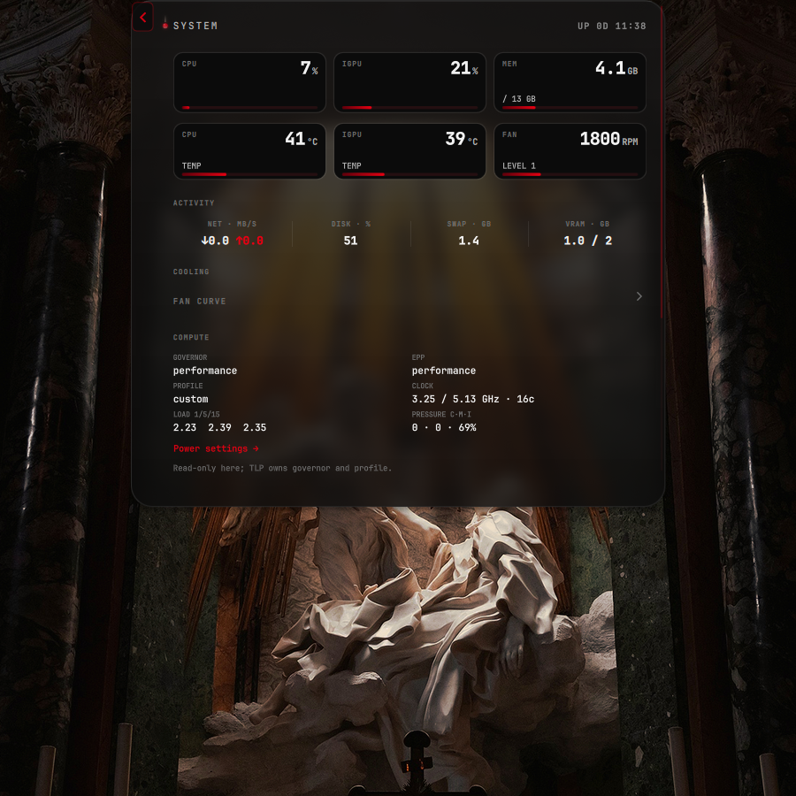
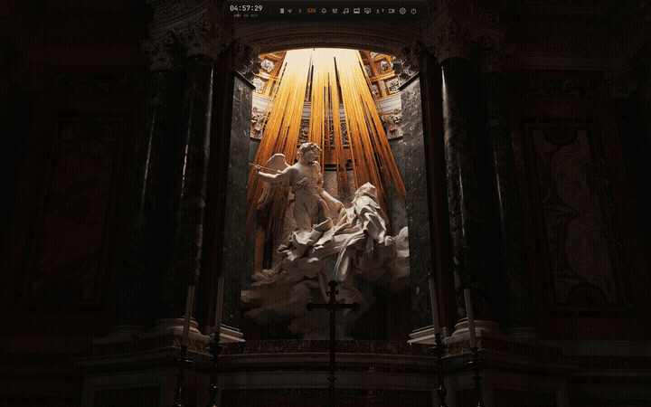

<div align="center">

# reddot

A Hyprland desktop shell built around one morphing Quickshell pill.

Personal fork of [Ricelin](https://github.com/Gakuseei/Ricelin), maintained on a ThinkPad E14 Gen 7.



</div>

reddot turns the top of the screen into a single pill that expands into the panel you need. It carries the bar, launcher, mixer, calendar, lock screen, power controls and the system pages, then collapses back to a small status strip.

The project is a working personal setup, not a distribution. The installer handles the supported package families, and the documentation records what has been tested on real hardware.

## Highlights

### One pill, many surfaces

The pill has 41 surfaces: settings, launcher, clipboard, wallpaper picker, media, mixer, calendar, notifications, network, Bluetooth, battery, power, security, system monitor, recorder and the ThinkPad tools.

Use the wheel, the scrollbar or `PageUp`/`PageDown` on long pages. `Home` and `End` jump to the edges. `Super+Shift+Space` reopens the last surface.




### Search that knows the interface

`Settings → Search` ranks pages by title, alias and tag. It accepts typos and informal names:

```text
gui          → Bar layout
organize     → Bar layout
fingerprint  → Security
fan           → ThinkPad
touchpad      → Input
```

The Search surface uses the same navigation manifest as the Settings index and the status bar, so labels and destinations have one source of truth.


### A bar you can rearrange

The status cluster supports drag reordering, visibility toggles and keyboard movement. The Bar page follows the same rules, and the layout survives a restart.


### Security and the lock screen

The lock screen authenticates with PAM. Password and fingerprint are independent contexts: a rejected password does not consume the fingerprint prompt, and a failed fingerprint returns to the password state without an automatic loop.

Fingerprint is optional and configurable in `Settings → Security`. Availability is detected from `fprintd` and the enrolled-print list.

### Power and hardware

The Power page covers TLP profiles, charge thresholds, pause/resume and the session actions. The battery card uses UPower history for 24-hour discharge bars and averages.

On ThinkPad hardware, the optional helper exposes fan RPM, thermal sensors, the fan curve, TrackPoint settings and keyboard LEDs. The System surface reads native hwmon and power-supply data through a small Rust scanner.

### Package updates for more than Arch

The package meter reads the native update source for the running system:

| System | Source |
|---|---|
| Arch | `pacman` and optional AUR via `yay` or `paru` |
| Fedora and RHEL family | `dnf` RPM updates |
| openSUSE | `zypper` RPM updates |
| Debian and Ubuntu | `apt` |
| Any system | optional Flatpak updates |

The page shows only the sources present on the machine, so Fedora does not reserve a row for AUR and a machine without Flatpak does not show an empty Flatpak chip. Kernel, initramfs, bootloader, firmware and core desktop packages are marked as important.

The check is read-only. On Arch it uses `checkupdates` when available, which refreshes a temporary sync database without root, and falls back to the cached `pacman -Qu`. It never runs `pacman -Syu`; applying updates stays an explicit user action. dnf, zypper and apt read their own cached metadata. A package manager holding its database lock during an upgrade cannot leave the page in `checking` because each probe has a 25 second ceiling.

### Appearance and effects

matugen derives a palette from the current wallpaper and feeds it to the pill, terminal, borders, fastfetch and GTK apps. Window blur, transparency and panel blur are separate controls. `Super+Shift+F` toggles window blur and opacity; panel blur stays independent.

### Recording and capture

`Super+Shift+R` opens the recorder. `Print` or `Super+F9` starts rishot, and `Shift+Print` captures the current monitor. rishot lives in its own project.

## Install

The bootstrap detects the package family, installs the required tools, clones reddot and starts the Python installer.

```sh
curl -fsSL https://raw.githubusercontent.com/SrRenks/reddot/e14g7/install.sh | bash
```

Read `install.sh` before piping it. The installer makes backups of replaced configuration.

Non-interactive options:

```text
--quickstart   core defaults, no questions
--full         include the daily applications
--sddm         install the torii SDDM theme
--no-deps      deploy configuration only
--dry-run      run the flow without changing anything
--skip-extras  skip TLP, ThinkPad and user-tool installation
```

Supported package families: Arch, Debian, Fedora, openSUSE and Gentoo. The documented target is Hyprland on Wayland. Other compositors only make sense for the standalone rishot capture tool.

## Keybinds

The active map lives in `configs/hypr/modules/binds.lua` and is documented in [docs/KEYBINDS.md](docs/KEYBINDS.md).

| Keys | Action |
|---|---|
| `Super+Return` | Terminal |
| `Super+A` | Launcher |
| `Super+V` | Clipboard history |
| `Super+W` | Wallpaper picker |
| `Super+Shift+W` | Apply a new wallpaper |
| `Super+E` | File manager |
| `Super+L` | Lock |
| `Super+F` | Fullscreen |
| `Super+Shift+Space` | Open or close the pill, restoring the last surface |
| `Super+1..0` | Focus workspace |
| `Super+Shift+1..0` | Move window to workspace |
| `Super+Shift+B` | Power surface |
| `Super+Shift+T` | ThinkPad surface |
| `Super+Shift+F` | Window blur and transparency |
| `Super+Shift+R` | Recorder |
| `Super+Shift+C` | Color picker |
| `Super+Shift+E` | EasyEffects bypass |
| `Super+G` | Game mode |
| `Super+S`, `Super+Shift+S` | Stash, send window to stash |
| `Super+T` | Toggle floating |
| `Super+M`, `Super+Shift+M` | Minimize, minimized stash |
| `Super+Space` | Keyboard layout |
| `Print`, `Super+F9` | rishot |
| `Shift+Print`, `Super+Shift+Print` | Capture current monitor |

The Keybinds page can edit the active file. Dynamic workspace binds from `spaces.lua` are documented but are not listed in the editor.

## Stack

| Layer | Technology |
|---|---|
| Compositor | Hyprland, configured in Lua |
| Shell | Quickshell and hand-written QML |
| Terminal | Ghostty |
| Shell environment | fish |
| Font | JetBrains Mono Nerd |
| Palette | matugen and the Rust wallcolors engine |
| Installer | Python 3 |
| Update engine | Rust, built by the extras step |
| Sensor snapshot | Rust, built only when needed |
| Configuration and helpers | POSIX shell and systemd user units |

The bootstrap installs git and rustc and runs the crate-free Rust installer. Python remains a rollout fallback and test harness, not the install prerequisite. The update engine, palette engine and sensor scanner are small Rust binaries compiled by `tools/install-extras.sh`; they have no runtime crate dependency and fall back to Python only while the binaries are absent.

## Project quality

The repository has a read-only checkout gate and a headless CI gate:

```sh
tools/check.sh
tools/check-static.sh
```

They cover QML lint with a reviewed warning baseline, surface and navigation contracts, pure JavaScript tests, helper tests, installer matrix and deploy sandbox checks, Lua syntax, Hyprland API rules and documentation links. Runtime checks that require a compositor or a real lock session stay supervised and are recorded in [docs/coverage.md](docs/coverage.md).

The live system was tested with real PAM unlock, password and fingerprint, two lock outputs, Bar drag and wheel, Search, host PSS measurements and a real package probe.

## Performance and trade-offs

Memory was measured on the live Arch session, not in CI. The host is the ThinkPad E14 Gen 7 at 1920x1200 with Quickshell 0.3.2. Values are in kB and come from `/proc/<pid>/smaps_rollup`; PSS includes shared pages in proportion to the process, while RSS is the larger resident figure.

| State | PSS | RSS |
|---|---:|---:|
| Pill closed, cold sample | 249853 | 340568 |
| Shell open | 250158 | 341524 |
| System open | 255633 | 349540 |
| Packages open | 254749 | 348656 |
| All 40 surfaces, pre-Search diagnostic sweep | 348915 | 450376 |
| Closed, 64 s after the sweep | 290775 | 384784 |
| Lock process, resident | 51764 | 108884 |

The all-surface row is not a steady state. Cold surfaces unload after 30 seconds and the allocator releases memory gradually. The current budget is deliberately above the measured medians so a cold-start sample does not make the check noisy:

| State | PSS budget |
|---|---:|
| Fresh pill idle | 270000 |
| Closed 60 s after a surface sweep | 310000 |
| Resident lock | 60000 |

The host-only checker is `tools/test-perf-budget.sh`. It fails when the sandbox hides `/proc` instead of reporting a false pass. The detailed procedure and measurements are in [docs/performance.md](docs/performance.md).

### Default RAM footprint

For a default session without the browser, private anonymous memory from `smaps_rollup` is the useful number. It excludes shared Qt pages, so the processes can be added without charging the same library more than once.

| Setup | Private anonymous | PSS, for reference |
|---|---:|---:|
| Hyprland + pill | 281 MiB | 380 MiB |
| Hyprland + pill + resident lock + polkit agent | 388 MiB | 523 MiB |

Measured on this ThinkPad E14 Gen 7:

```text
Hyprland         87.9 MiB private
qs -c pill      193.5 MiB private
qs -c lock       73.3 MiB private
hyprpolkitagent  33.0 MiB private
```

The browser is deliberately excluded. Zen alone is larger than the complete shell, so including the browser would measure the tab workload, not reddot.

On a 16 GiB machine, 281 MiB is about 1.7% and the full 388 MiB about 2.4%. On 8 GiB, those become about 3.4% and 4.7%. This is acceptable for a feature-dense Qt shell and sits at the low end of the 250 to 400 MiB QuickShell band. It is not excellent: Waybar plus separate tray, launcher and locker can do 60 to 120 MiB, but loses the single morphing pill.

The practical limit for this design is close. The largest remaining saving is the resident lock: starting it on demand could save about 74 MiB private memory, but it adds a 200 to 400 ms start on the security path and a failed spawn must never expose the session. I chose the warm lock. Dropping KDE Connect saves roughly 40 MiB if phone integration is not needed. A second monitor would add another Pill scene graph, so a per-monitor policy matters more there than micro-tuning.

Do not expect large wins from timer cleanups or surface unloading: cold surfaces already unload after 30 seconds, and jemalloc decay is already enabled. Below this point the honest options are removing features or changing the shell architecture.

### Notes on the decisions

I keep the lock process resident. It costs roughly 50 MB PSS, but a lock that is warm starts immediately and does not depend on spawning a Qt process during the critical path. I chose that trade for a personal machine where unlock latency and fail-closed behavior matter more than the last few megabytes.

I moved the updater to Rust as the first migration phase. It has a closed JSON contract and a git/merge test surface, so I could prove parity without rewriting the installer at the same time. The installer remains Python because its distro logic and terminal UI are a larger risk and do not affect idle memory. The remaining plan and the fallback are in [ADR 0003](docs/decisions/0003-rust-update-engine.md).

I keep one scroll implementation and one navigation vocabulary. The pill, Settings, Search and the status order all use the same surface catalog and metadata, even when that leaves the Settings pages appearing to do similar work. Duplicated behavior was causing drift, and the shared model makes the contracts testable.

I made Search page-first on purpose. Opening a section is stable and predictable; focusing a specific row needs a stable row key and a focus contract across every page. That is the next layer, not something to fake with an index.

Fingerprint remains optional. Any enrolled finger can authenticate through `pam_fprintd`; that is the module's behavior, not a per-finger policy in the shell. Password and fingerprint are separate PAM contexts, so a failed password does not consume the fingerprint prompt.

The numbers above are diagnostic for this machine. They are not a promise for another GPU, wallpaper pipeline, monitor layout or Qt build.

## Project layout

| Path | Contents |
|---|---|
| `configs/hypr/` | Hyprland Lua modules, scripts and helpers |
| `configs/quickshell/pill/` | Pill surfaces, navigation, status and settings |
| `configs/quickshell/lock/` | Lock surfaces and PAM authentication |
| `configs/fish/`, `configs/ghostty/` | Shell and terminal configuration |
| `installer/` | Guided installer and package manifest |
| `tools/` | Validation gates, tests and host utilities |
| `docs/` | Architecture, operations, coverage and roadmaps |
| `assets/` | Screenshots and README recordings |

## Documentation

Start at [docs/index.md](docs/index.md). The most useful entry points:

- [Getting started](docs/getting-started.md)
- [Architecture](docs/architecture.md)
- [Conventions](docs/conventions.md)
- [Keybinds](docs/KEYBINDS.md)
- [ThinkPad controls](docs/THINKPAD.md)
- [Power and energy](docs/POWER.md)
- [Performance](docs/performance.md)
- [Validation checklist](docs/validation-checklist.md)
- [Coverage and remaining gaps](docs/coverage.md)
- [Architecture decisions](docs/decisions/index.md)
- [Rust update engine](docs/decisions/0003-rust-update-engine.md)
- [Rust palette engine](docs/decisions/0004-rust-palette-engine.md)

The project roadmap and open validation work live in [docs/roadmap.md](docs/roadmap.md).

## Acknowledgements

reddot is an independent fork of [Ricelin](https://github.com/Gakuseei/Ricelin), created by [Gakuseei](https://github.com/Gakuseei). The pill concept, the interaction model and the original implementation are his work. Upstream code is MIT licensed, and the upstream credits continue to apply to everything inherited from it.

The sound page began as a proposal by [@Seza007](https://github.com/Seza007) in the upstream Ricelin issue tracker. AutoEQ profiles come from [AutoEq](https://github.com/jaakkopasanen/AutoEq). [rishot](https://github.com/Gakuseei/rishot) provides the screenshot and annotation workflow.

Wallpapers and the SDDM background are third-party assets and are documented in [WALLPAPERS.md](WALLPAPERS.md) and [configs/sddm/themes/torii/CREDITS.md](configs/sddm/themes/torii/CREDITS.md).

## License

MIT. Upstream code © 2026 Gakuseei. reddot-specific changes © 2026 Ricardo Castro (SrRenks). See [LICENSE](LICENSE).
