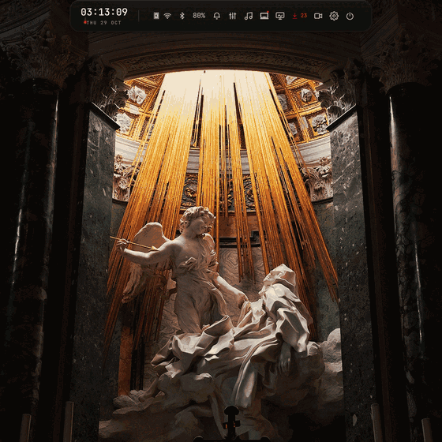
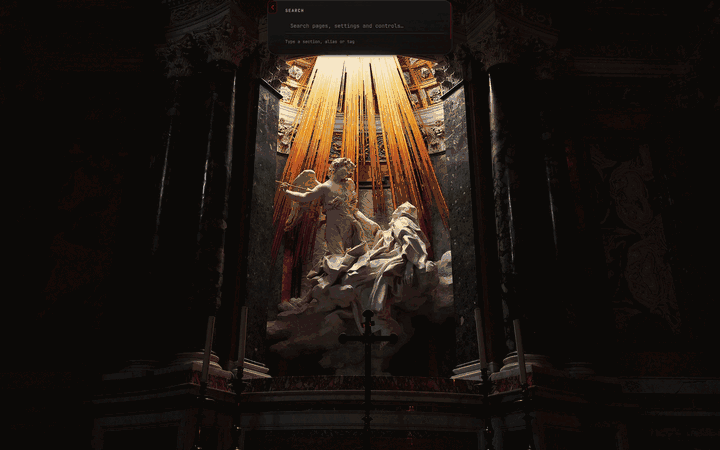
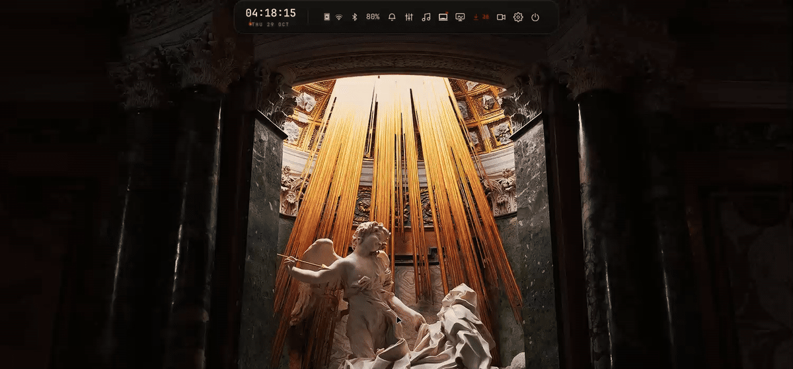

# Usage

The pill is the interface. It starts as a status strip at the top of the screen
and morphs into the page you choose.

## Opening

- `Super+Shift+Space` opens or closes the last surface.
- Hover the top strip, or use `Super+A` for the launcher.
- `Search` opens from the launcher or Settings and finds pages by title, alias or
  tag.
- `Escape` closes the current surface; the back control returns to the parent
  page.
- The wheel, scrollbar, `PageUp`/`PageDown`, `Home` and `End` work on long pages.



## Surfaces

The shell has 41 surfaces. The main paths are:

| Area | Surfaces |
|---|---|
| Navigation | Launcher, Search, Settings |
| Desktop | Appearance, Bar, Shell, Windows, Display, Input, Security |
| System | System monitor, Packages, Updates, Maintenance |
| Audio and media | Mixer, Sound, Media, Recorder |
| Hardware | Battery, TLP, ThinkPad |
| Session | Power, Calendar, Clipboard, Notifications, Wallpaper |

Settings is a hub: `Appearance`, `Shell`, `Windows` and `Display` under Desktop;
`Input`, `Security` and `Shortcuts` under Controls; `Power`, `System` and
`Maintenance` under System.

## Search



Search ranks the navigation manifest. Examples:

```text
wifi         → Wi-Fi
volume       → Mixer
fingerprint  → Security
fan          → ThinkPad
gui          → Bar layout
```

## Bar



The normal bar exposes the clock and status icons. Clicking Wi‑Fi, battery or the
package meter opens the matching surface; the status cluster can be reordered,
hidden and moved between zones. Settings → Shell → Bar mirrors the same order and
survives a restart.

## Keybinds

The active map is `configs/hypr/modules/binds.lua`. Core bindings:

| Keys | Action |
|---|---|
| `Super+Return` | Terminal |
| `Super+A` | Launcher |
| `Super+V` | Clipboard |
| `Super+W` | Wallpaper picker |
| `Super+L` | Lock |
| `Super+F` | Fullscreen |
| `Super+M`, `Super+Shift+M` | Minimize / minimized stash |
| `Super+S`, `Super+Shift+S` | Stash / send window to stash |
| `Super+Space` | Keyboard layout |
| `Super+Shift+R` | Recorder |
| `Print`, `Super+F9` | rishot |
| `Shift+Print` | Capture current monitor |

## Lock

The lock uses PAM. Password and fingerprint are independent, and any enrolled
finger can authenticate through `pam_fprintd`. On multiple monitors, the
primary output carries authentication; secondary outputs show the clock, date
and a `LOCKED` marker. A physical lock test with two outputs is recorded in
[coverage.md](coverage.md).
